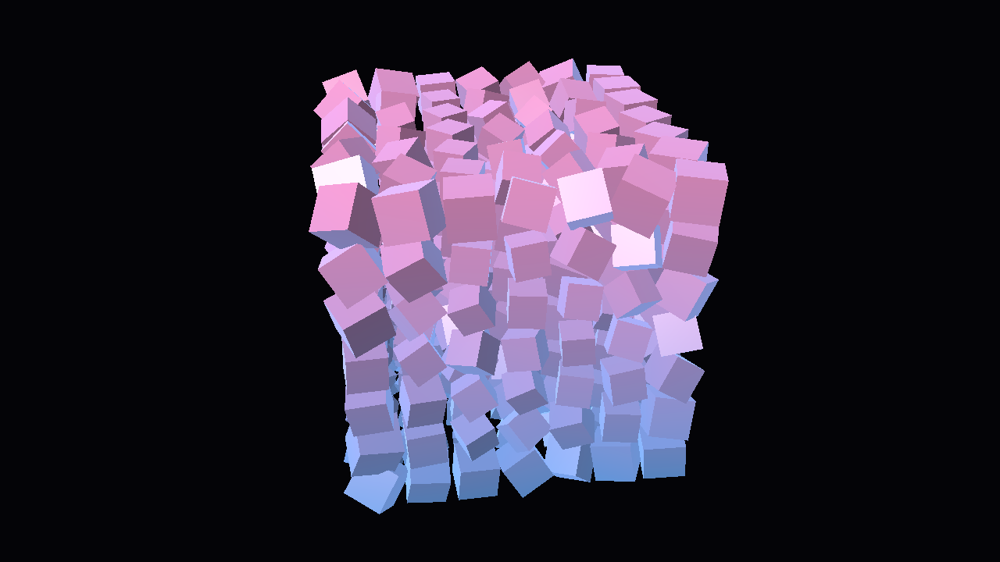

# Byta

现代、零分配开销的 .NET OpenGL 封装。绑定从 Khronos 官方注册表生成，调用走函数指针表；**不认死系统那个 GL 实现**——能自带一份更高版本的就去用。

```csharp
// 自动挑"能给出的最高版本"的实现：内置 Mesa(4.6) → 系统 CGL(4.1)
using var session = BytaRuntime.Initialize();
//  实现 : Byta 内置实现（Mesa/EGL）    上下文 : GL 4.6 core | llvmpipe | GLSL 4.60 | 233 ext
// 或者强制用系统那个：new BytaOptions { PreferBundledImplementation = false }

using var program = GlProgram.FromSource(vertexGlsl, fragmentGlsl);
using var vao = GlVertexArray.Create();
vao.Bind();
buffer.Bind();
GlVertexArray.Attribute(0, 3, VertexAttribType.Float, strideBytes: 32);

program.Use();
program.GetUniform("uViewProjection").Set(viewProjection);
GlDraw.ElementsInstanced(PrimitiveType.Triangles, 36, IndexType.UnsignedInt, 0, 1000);
```



两张图分别来自 **GL 4.6 / Mesa llvmpipe** 与 **GL 4.1 / Apple CGL**，同一个示例、同一份 GLSL，输出**逐像素一致**（74.3 KB，亮度 27.10%）——这是对封装层正确性最直接的验证。

---

## 为什么不听 Apple 的 4.1

macOS 自带 OpenGL 封顶在 **4.1**（Apple 把它架在 Metal 之上，不再往上做）。这不是"请求个高版本号"能解决的：`kCGLOGLPVersion_4_1_Core` 就是天花板，4.4 的 `glBufferStorage`、4.2 的 `glTexStorage2D`、4.3 的 compute shader 全都没有。

所以 Byta 的做法是：**实现是可替换的**。

| 顺序 | 实现 | 怎么来 | 上限 |
| --- | --- | --- | --- |
| 1 | 内置 Mesa（EGL + llvmpipe） | 随库分发在 `src/Byta/runtimes/osx-arm64/native/` | **GL 4.6 core** |
| 2 | `BYTA_GL_DRIVER` 指定的实现 | 环境变量指向任意 `libEGL` | 看那份实现 |
| 3 | 系统实现（Apple CGL） | 兜底 | GL 4.1 |

初始化时从 4.6 往下逐级试（4.6 → 4.5 → … → 3.3），第一个能建出上下文的就用它，并把"试过什么、为什么失败"记在 `session.Attempts` 里：

```csharp
using var session = BytaRuntime.Initialize(new BytaOptions { Log = Console.WriteLine });
Console.WriteLine(session.Implementation.Name);   // Byta 内置实现（Mesa/EGL：libEGL.1.dylib）
Console.WriteLine(session.Capabilities.Version);  // 4.6
```

想用自己已经有的上下文（GLFW / SDL / Avalonia / WinForms）也完全可以，它只是其中一条路：

```csharp
var session = BytaRuntime.Initialize(myGlContext, name => glfwGetProcAddress(name));
```

### 代价必须说清楚

两套实现给的能力完全不同，别指望"免费的 4.6"：

| | GL 4.6（内置 llvmpipe） | GL 4.1（Apple CGL） |
| --- | --- | --- |
| 渲染位置 | **CPU**（LLVM 编译的软件光栅器） | GPU（Metal） |
| 三角形吞吐 | 2.1 M tri/s | 133.7 M tri/s |
| 320×180 一帧 | 1.95 ms | 约 0.03 ms |
| 扩展数 | 233 | 43 |
| `glBufferStorage` / compute shader / DSA | 有 | 无 |
| KHR_debug（驱动自己报错） | **可用** | 不可用 |

**结论**：要 4.6 的新特性、要跑可重复的离屏/CI 渲染、要驱动级调试信息 → 内置实现；要吞吐 → 系统那个 4.1（或者干脆上 Metal/Vulkan）。

> 为什么不是硬件 4.6？本想走 Mesa 的 zink（GL→Vulkan→Metal），实测被 MoltenVK 挡住：
> `Zink requires the nullDescriptor feature of KHR/EXT robustness2`。MoltenVK 目前不提供该特性，
> 所以 zink 建不出设备，Mesa 静默回退到 llvmpipe。`BYTA_EGL_DRIVER=zink` 可以自己验证这条死路。

## 为什么快（封装层本身）

| 设计 | 具体做法 | 效果 |
| --- | --- | --- |
| 不用 P/Invoke stub | 2651 条命令全部生成成 `delegate* unmanaged<...>` 静态字段 | 没有 marshal stub、没有 GC transition stub |
| 签名全 blittable | 只用 `int`/`uint`/`nint`/`float`/`byte*`/`void*` | 调用期零封送 |
| 状态缓存 | VAO / Program / Buffer / 纹理单元 / FBO / viewport / 开关按线程缓存 | 缓存命中 1.7~3.4 ns，直通驱动 4~26 ns |
| 值句柄 | `GlBuffer`、`GlTexture2D`、`GlVertexArray`… 都是 `readonly struct` | 建对象不分配堆内存 |
| 零分配上传 | `Allocate<T>(ReadOnlySpan<T>)` / `Upload<T>(ReadOnlySpan<T>)` 用 `fixed` 直接交给驱动 | 不拷贝、不装箱 |
| DSA 设置 uniform | `GlUniform` 走 `glProgramUniform*` | 改别的程序 uniform 不用先 `UseProgram` |

实测（Apple M5，1280×720，Apple CGL 4.1 路径）：实例化绘制提交 436 ns/次，热路径托管分配 **0 字节**，缓冲上传 12.5 GB/s。

## 结构

```
byta/
├── registry/gl.xml                 Khronos 官方注册表（vendored）
├── tools/
│   ├── glgen/gen.py                gl.xml → C# 绑定生成器
│   └── fetch_natives.py            从 Homebrew bottle 拼原生实现（不需要 brew install）
├── src/
│   ├── Byta.Bindings/              生成的裸绑定（无依赖）
│   │   ├── Generated/Gl.Commands.g.cs     2651 条命令：函数指针字段 + 加载器
│   │   ├── Generated/Gl.Constants.g.cs     6073 个常量（去 GL_ 前缀）
│   │   └── Gl.Loader.cs                    GL.Load / TryLoad / Missing / GetProcAddress
│   └── Byta/                       高层封装
│       ├── BytaRuntime.cs           实现选择 + 版本降级探测 + 初始化
│       ├── GlState.cs              线程局部状态缓存
│       ├── GlCapabilities.cs       版本 / 扩展 / 上限
│       ├── GlDebug.cs              错误检查 + KHR_debug 回调
│       ├── Objects/                Buffer / VertexArray / Shader / Program / Uniform /
│       │                           Texture2D / Framebuffer / Renderbuffer / Query
│       ├── Platform/
│       │   ├── GlImplementation.cs  可插拔实现的发现与描述
│       │   ├── EglContext.cs        EGL 离屏上下文（surfaceless + pbuffer）
│       │   ├── MacCglContext.cs     Apple CGL 离屏上下文
│       │   └── GlProcResolvers.cs   进程内符号解析（macOS/Win32/Linux）
│       └── runtimes/osx-arm64/native/   内置实现（208 MB，见下）
├── samples/Byta.Sample/            真实渲染 + PNG 输出 + 基准（可 --system 对照）
└── tests/Byta.Tests/               32 项真跑断言
```

## 内置实现怎么来的

`brew install mesa` 在这台机器上跑不起来（Homebrew 的安装沙箱 `sandbox-exec` 被系统拒绝），而且 bottle 里的 dylib 引用的是 `@@HOMEBREW_PREFIX@@` 占位符，装完才改写。所以改成直接从 bottle 拼：

```bash
# 先把 bottle 下到本机缓存（只下载，不安装）
brew fetch --force --bottle-tag=arm64_golden_gate mesa vulkan-loader molten-vk llvm \
    zstd spirv-tools libx11 libxcb libxau libxdmcp

# 拼闭包：解包 → 递归 otool 依赖 → 全拷到 runtimes/<rid>/native/
#        → install name 改成 @loader_path/<名字> → ad-hoc 重签
python3 tools/fetch_natives.py --rid osx-arm64
```

脚本干的三件关键事：**递归解引用**（含运行时 dlopen 的 `dri/*_dri.dylib`）、**把 install name 重写成 `@loader_path`**（否则整包搬走就加载不了）、**重新做 ad-hoc 签名**（arm64 上改过 Mach-O 不重签会被 dyld 拒绝）。

体积构成：`libLLVM.23.1.dylib` 160.6 MB + `libz3` 18.5 MB + `libgallium` 16.1 MB + MoltenVK 5.1 MB ≈ **208 MB**。
不想要这份砸盘的话删掉 `src/Byta/runtimes/` 即可，Byta 会自动回退到系统实现；要再拿回来就重跑上面脚本。

## 覆盖与校验

| 项目 | 数值 |
| --- | --- |
| 生成的命令 | 2651（GL 4.6 core + 全部扩展） |
| 生成的常量 | 6073 |
| 主动跳过 | 15（CL/EGL/Vulkan 互操作句柄） |
| Apple 4.1 入口点解析率 | 478 / 508 = **94.09 %** |
| 内置 4.6 入口点缺失 | 904（都是更冷门的厂商扩展） |

Apple 那 30 条缺失全是立即模式的打包顶点函数（`glColorP3ui`、`glVertexP2uiv` 等），用 `dlsym` 单独确认过是驱动本身没有，不是解析器问题。

## 测试

```bash
dotnet run --project tests/Byta.Tests -c Release            # 内置 4.6
dotnet run --project tests/Byta.Tests -c Release -- --system  # Apple 4.1
```

32 项，两套实现都全通过。覆盖：入口点解析、能力查询、缓冲往返（`glGetBufferSubData` 逐值比对）、带偏移的部分上传、着色器编译失败路径、uniform 写读、纹理上传→FBO 回读逐字节比对、不完整 FBO 检测、**VAO 切换时索引缓冲跟着切换**、深度测试真的拒绝远处像素、实例化真的画到三个位置、2000 次绘制托管分配 = 0 字节。

## 踩到并修掉的坑

1. **ELEMENT_ARRAY_BUFFER 的绑定属于 VAO 状态**，当全局状态缓存会导致切 VAO 后用错索引缓冲（画面全黑 + `INVALID_OPERATION`）。留了回归测试。
2. **core profile 没有默认 VAO**，绑索引缓冲前必须先绑一个。
3. **`DebugMessageControl` 的 severity 只接受单个 `DEBUG_SEVERITY_*` 枚举值**，不是位掩码——传位掩码会 `INVALID_ENUM`。这个 bug 在 Apple 4.1 上永远看不到（它没有 KHR_debug），换成 4.6 实现第一分钟就炸了。
4. **Mesa 指定驱动失败会静默回退**，所以驱动名必须从 `GL_RENDERER` 读，不能信环境变量。
5. **Rosetta 下 RID 是 `osx-x64`**，而原生库是 arm64 —— 目录探测要同时看 `osx-arm64` / `osx-x64`，架构不对时加载失败并降级。

## 平台支持

| 平台 | 上下文 | 入口点解析 | 状态 |
| --- | --- | --- | --- |
| macOS | 内置 EGL（4.6）+ Apple CGL（4.1） | `dlsym` / `eglGetProcAddress` | **已实测** |
| Windows | 自带（GLFW/SDL/WinForms） | `wglGetProcAddress` + `opengl32.dll` 回落 | 代码已实现，**未在本机验证** |
| Linux | 自带（GLFW/SDL/GLX/EGL） | `glXGetProcAddressARB` + `libGL` 回落 | 代码已实现，**未在本机验证** |

## 已知限制

- **不创建窗口。** 窗口/事件循环属于宿主框架。内置实现是离屏的（EGL pbuffer + FBO），Apple 实现是 CGL 离屏，都适合后台线程与 CI。
- **内置实现是 CPU 渲染**，吞吐比 GPU 低约两个数量级（见上表）。它不是"免费的 4.6"。
- **zink 硬件路径在 MoltenVK 上不可用**（缺 `VK_EXT_robustness2` 的 `nullDescriptor`）。
- **状态缓存的边界**：缓存按线程存，若绕过封装直接改绑定，请 `GlState.Invalidate()`；换上下文后 `GlState.Reset()`。
- **错误检查不是逐调用**：只在创建/编译/链接/校验这类慢路径上查 `glGetError`，绘制热路径不查（查了就是每帧强制同步）。
- Windows / Linux 解析器没有真机验证过，表格里已标注。

## 克隆

原生实现（20 个 dylib，208 MB）走 **Git LFS**，所以克隆前先装 lfs：

```bash
brew install git-lfs && git lfs install
git clone https://github.com/Hub-Game-develop/Byta.git
```

不想拉 LFS 内容（只要源码）就先跳过：

```bash
GIT_LFS_SKIP_SMUDGE=1 git clone https://github.com/Hub-Game-develop/Byta.git
python3 tools/fetch_natives.py     # 之后按需重建原生实现
```

## 安装

```bash
dotnet add package Byta.GL          # 桌面：对象层 + macOS 内置 Mesa(4.6) 实现
dotnet add package Byta.Browser     # 浏览器：WebGL2 后端（自动带上 Byta.GL）
```

| 包 | 用途 | 下载体积 |
| --- | --- | --- |
| `Byta.GL` | 对象层 + 内置原生实现 | 67 MB（含 208 MB 未压缩原生库） |
| `Byta.Browser` | 浏览器 WebGL2 后端 | 38 KB |
| `Byta.Bindings` | 裸绑定层（上面两个会自动带上，通常不用单独引用） | 168 KB |

只装 `Byta.Browser` 时**不会**把 208 MB 原生库拷进输出目录（包内 targets 会默认
把 `BytaIncludeBundledNative` 设为 `false`），输出目录约 1.6 MB。

## 文档站

线上地址：**https://hub-game-develop.github.io/Byta/api/**

它不是静态生成的 HTML，而是一个 **Avalonia 12 + FluentUI-CodeHub** 的桌面级应用，
通过 **Avalonia.Browser 编译成 WASM** 跑在浏览器里 —— 和 Byta 一样，一套 .NET 代码
同时是桌面程序和网页。

```
tools/Byta.DocsGen/       # 反射 Byta.dll + Byta.xml → api.json（构建期）
docs/Byta.Docs/           # 共享 UI（FluentUI-CodeHub 的 FAInfoBar / FASkeleton）
docs/Byta.Docs.Desktop/   # 桌面宿主，本地可直接跑
docs/Byta.Docs.Browser/   # WASM 宿主，GitHub Pages 部署的就是它
```

```bash
# 生成 API 数据（改了公开 API 后要重跑）
dotnet run --project tools/Byta.DocsGen -c Release -- docs/Byta.Docs/Assets/api.json

# 本地看效果（桌面版，最快）
dotnet run --project docs/Byta.Docs.Desktop

# 无头渲染一张截图，检查版式
dotnet run --project tools/Byta.DocsPreview -- /tmp/docs.png GlBuffer
```

数据来自**反射 + XML 文档注释**（`GenerateDocumentationFile`），所以签名永远和代码一致，
不会出现"文档写的方法早就改名了"这种事。`GlApi`（5306 个成员）和 `GL`（8734 个命令）
这类生成代码只显示类型级摘要，逐条列出会淹没页面。

## WebGL2（浏览器里跑同一套 API）

Byta 的 GL 调用有一层门面（`GlApi`）：**有后端时转发给后端，没有时直连原生函数指针**。
所以同一份渲染代码既能在本机跑原生 GL，也能在浏览器里跑 WebGL2：

```csharp
var capabilities = await BytaBrowserRuntime.InitializeAsync("byta-canvas");

using var program = GlProgram.FromSource(vertex, fragment);   // 与原生完全一致
using var vao = GlVertexArray.Create();
vao.Bind();
GlDraw.ElementsInstanced(PrimitiveType.Triangles, 36, IndexType.UnsignedInt, 0, 49);
```

- 演示：`https://hub-game-develop.github.io/Byta/`（由 `build.yml` 构建并部署）
- 覆盖范围：**GLES 3.0 核心**，即 WebGL2 能给的全部；桌面 GL 专有的命令
  （`glBufferStorage`、`glMapBuffer`、`glDebugMessageCallback`）会抛
  `GlNotSupportedException`，可以先用 `GlApi.IsAvailable("glBufferStorage")` 判断。
- DSA 的 `glProgramUniform*` 在 WebGL 下自动退化为 `glUseProgram` + `glUniform*`。
- 着色器版本自动切换：原生用 `#version 410`，WebGL 用 `#version 300 es`（并自动补 `precision`）。
  `uniformMatrix4fv` 的 `transpose=true` 在 WebGL 里非法，`GlUniform` 会自动改成物理转置 + `false`。

代价：原生路径多一次可预测的分支（`Backend is null`），实测在噪声级别，
换来的是"一套代码、两个平台"。

## 构建

```bash
./build.sh                     # 推荐：逐个项目构建，两个 SDK 都能用
./build.sh Release --test      # 构建完顺手跑测试
DOTNET=~/dotnet11x64/dotnet ./build.sh   # 指定 SDK
```

**为什么不直接 `dotnet build Byta.slnx`**：这台机器上 arm64 的 CodeNet SDK 构建 `.slnx` 会
SIGSEGV(139) / `MSB4166 子节点过早退出`，加 `-m:1`、`-p:BuildInParallel=false` 都绕不过去；
但**逐个项目构建完全正常**，x64 SDK 构建 `.slnx` 也正常。`build.sh` 就是干这个的。

跑示例 / 测试：

```bash
dotnet run --project samples/Byta.Sample -c Release -- --out render.png
dotnet run --project samples/Byta.Sample -c Release -- --bench
dotnet run --project samples/Byta.Sample -c Release -- --impl      # 列出实现 + 搜索目录 + 跳过原因
dotnet run --project samples/Byta.Sample -c Release -- --system    # 强制 Apple 4.1 对照
dotnet run --project tests/Byta.Tests -c Release                   # 内置 4.6 跑测试
dotnet run --project tests/Byta.Tests -c Release -- --system        # Apple 4.1 跑测试
```

`net10.0`，`unsafe` + AOT 友好（无反射）。要换 TFM 改 `Directory.Build.props` 一处。

## 常见问题

**为什么我 `--impl` 里内置实现被跳过了？**
它会直接告诉你原因，比如：

```
  跳过的候选:
    libEGL.1.dylib：架构不匹配：库是 arm64，当前进程是 x86_64
```

内置实现是 arm64 原生库，而 x64 进程（Rosetta）加载不了 arm64。用 arm64 的 SDK 构建并运行
（`dotnet run --project ...` 用 PATH 里那个 arm64 的 `dotnet` 就行），Built-in 4.6 就出来了。
架构判断是自己读 Mach-O 头做的（支持 fat 二进制），不是靠"试一下崩了就 catch"。

**构建/运行时报 `Failed to create CoreCLR, HRESULT: 0x8007000C` / `0x8007000E` / `0x8007054F`？**
跟 Byta 无关，是 macOS 27 上 .NET 的老问题（EXC_GUARD，社区里叫 Wall#2）：

| 值 | 谁身上出现 | 说明 |
| --- | --- | --- |
| `0x8007000C` | **官方** arm64 .NET | 必现，Mach exception 路径被系统拦掉 |
| `0x8007000E` / `0x8007054F` | CodeNet 的 signalfix 版 | 偶发，进程密集创建（MSBuild 派生节点）时更容易踩 |

处理办法：**用 CodeNet 的 signalfix 版 arm64 SDK**（`~/dotnet-arm64`）；偶发时重跑或重启。
`build.sh` 已经内置了这件事：会自动跳过起不来的 SDK、逐个项目构建、对这类瞬时失败重试。

**为什么 `build.sh --test` 提示"改用构建用的 SDK 跑一遍"？**
内置实现是 arm64 原生库，只有 arm64 进程能用；x64 进程（Rosetta）加载不了。所以：
- **构建**用 x64 SDK 最稳（arm64 的 CodeNet SDK 构建 `.slnx` 会 139）；
- **运行**要用 arm64 运行时才能拿到 4.6，arm64 运行时起不来时脚本会退回 x64 跑系统 4.1 路径，
  并明确告诉你"这次测的是 4.1"。

**引用 NuGet 包后，内置实现为什么还是没启用？**
`Byta.GL` 0.1.0 有这个坑：NuGet 的 `runtimes/<rid>/native` 约定**只在项目指定 `RuntimeIdentifier`
或 `dotnet publish -r` 时才复制到输出目录**。普通框架依赖项目不写 RID，于是原生库只待在
`~/.nuget/packages/` 里，输出目录空空 —— Byta 找不到 `libEGL`，安静回退系统实现。
**0.1.1 起已修**：包内带 `buildTransitive/Byta.GL.targets` 显式复制。

关掉自动复制：`<BytaIncludeBundledNative>false</BytaIncludeBundledNative>`。

**208 MB 能不能砍？**
能。删掉 `src/Byta/runtimes/` 就自动回退系统实现；要拿回来跑 `python3 tools/fetch_natives.py`。
真正想瘦身的话，正规做法是把这份原生库走 NuGet RID 包（`runtimes/<rid>/native`）单独发布，
而不是塞进源码仓库。

## 发布（NuGet Trusted Publishing）

用 OIDC 可信发布：**仓库里不存任何 API Key**。流程是「打 tag → GitHub Actions → 换取短期密钥 → 推送」。
工作流在 [`publish.yml`](.github/workflows/publish.yml)。

首次配置（各一次，在网页上点几下）：

1. **nuget.org → 头像 → Trusted Publishing → Add new policy**

   | 字段 | 填什么 |
   | --- | --- |
   | Repository Owner | `Hub-Game-develop` |
   | Repository | `Byta` |
   | Workflow File | `publish.yml` |
   | Environment | 留空（本工作流不使用 environment） |

2. **仓库 Settings → Secrets and variables → Actions → Variables** 新增
   `NUGET_USER` = 你在 nuget.org 上的**用户名**（个人资料页那个，不是邮箱）

发布：

```bash
git tag v0.1.0 && git push origin v0.1.0     # 触发发布
gh workflow run publish.yml -f version=0.1.1  # 或手动触发并指定版本
```

产物两个：`Byta.Bindings`（裸绑定，156 KB）和 `Byta.GL`（对象层 + macOS 原生实现，压缩后约 67 MB）。
本地打包：`dotnet pack src/Byta/Byta.csproj -c Release`，输出到 `artifacts/packages/`。

> ⚠️ 工作流里 `actions/checkout` 必须带 `lfs: true`，而且打包后会校验 `Byta.GL` 的体积。
> 否则 Git LFS 指针（134 字节）会被当成 dylib 打进包 —— 包看着正常，实际根本跑不起来。
> 这个检查是特意加的，别删。

## 宣传动画

`promo/` 里是用 **Blender 5.1 + Python（bpy）** 生成的宣传片，全流程脚本化：

```bash
cd promo
/Applications/Blender.app/Contents/MacOS/Blender -b --factory-startup --python build_promo.py   # 重建场景
/Applications/Blender.app/Contents/MacOS/Blender -b byta-promo.blend --python render.py -a      # 渲染 240 帧
./make_video.sh                                                                                  # 合成 mp4
```

- `promo/byta-promo.blend` —— **可直接交付的源文件**，Blender 打开就能改、就能 Render Animation
- `promo/byta-promo.mp4` —— 成片，1920×1080 / 24fps / 10 秒
- 场景刻意用项目自己的视觉语言：`#0B0D13` 底色、9×9 立方体阵列（间距 3.05、边长 2.3，
  就是 demo 那套参数）、深蓝→青蓝渐变、合成器 Glare 光晕

细节见 [promo/README.md](promo/README.md)。

### 电影感版：`promo/cinematic/`

另一支 11 秒短片：**纯黑背景 + 一行 Unifont 像素字 → 突然亮起的碎裂魔方（64 块碎片、
极速旋转、冷暖光对撞）→ 字幕 → `dotnet add package Byta.GL` → 黑屏**。
配乐《OverWorld-Infinity》同样由 Python 合成（加法合成钢琴 + FFT 卷积混响），无采样库。

```bash
cd promo/cinematic
/Applications/Blender.app/Contents/Resources/5.1/python/bin/python3.13 soundtrack.py     # 合成音乐
/Applications/Blender.app/Contents/MacOS/Blender -b --factory-startup --python build_cinematic.py
/Applications/Blender.app/Contents/MacOS/Blender -b byta-cinematic.blend --python render.py -a
./make_cinematic.sh
```

- `promo/cinematic/byta-cinematic.blend` —— 源文件（音轨已在 VSE 里）
- `promo/cinematic/byta-cinematic.mp4` —— 成片，1920×1080 / 24fps / 11s
- `promo/cinematic/OverWorld-Infinity.wav` —— 11.5s 配乐

细节与踩过的坑见 [promo/cinematic/README.md](promo/cinematic/README.md)。

## 许可证

MIT，见 [LICENSE](LICENSE)。

用到的第三方原生组件（随 Git LFS 分发的 `src/Byta/runtimes/`）各自保留原许可证：
Mesa（MIT）、LLVM（Apache-2.0 WITH LLVM-exception）、MoltenVK（Apache-2.0）、
Vulkan-Headers（Apache-2.0）、zstd（BSD-3-Clause）、z3（MIT）、SPIRV-Tools（Apache-2.0）。
重新分发时请一并保留这些许可声明。
